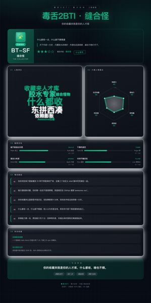
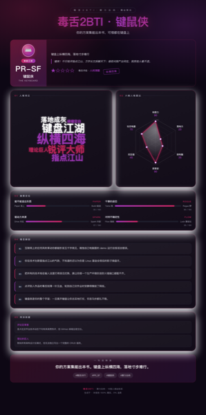
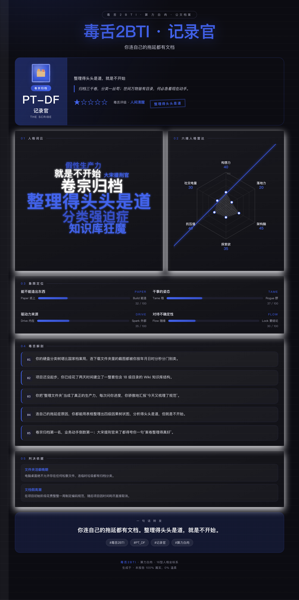

<p align="center">
  
</p>

# 毒舌2BTI · Savage 2BTI

<p align="center">
  <a href="https://github.com/HankGuo/dushe-2bti"></a>
  <a href="https://gitee.com/hank_guo/dushe-2bti"></a>
  <a href="./LICENSE"></a>
  
  <a href="https://github.com/HankGuo/dushe-2bti"></a>
  <a href="https://aichi.food"></a>
</p>

> **算力白肉出品** · 专为 AI 深度患者打造的自创 **16 型人格坐标系** + **四大视觉家族** + 一张能直接发朋友圈的毒舌人格长图。
>
> 词云 + 六维雷达 + 象限定位 + 五刀毒舌 + 真实判决依据，纯离线零外部依赖，一键生成！

---

## 视觉效果一览

16 型人格绝非简单的换色模版，而是由两级坐标派生出的 **四大独立视觉家族**（涵盖背景纹理、雷达填充、卡片质感、徽章符号与印章）：

<table>
  <tr>
    <td align="center" width="25%">
      <br>
      <b>BR-DL 狠人</b><br>
      <sub>施工现场 · 斜纹硬核</sub>
    </td>
    <td align="center" width="25%">
      <br>
      <b>BT-SF 缝合怪</b><br>
      <sub>工程蓝图 · 精密发光</sub>
    </td>
    <td align="center" width="25%">
      <br>
      <b>PR-SF 键鼠侠</b><br>
      <sub>舞台聚光 · 极简霓虹</sub>
    </td>
    <td align="center" width="25%">
      <br>
      <b>PT-DF 记录官</b><br>
      <sub>公文档案 · 羊皮卷纸</sub>
    </td>
  </tr>
</table>

---

## 极速安装

### 方式 A：Agent Skills 规范安装（推荐）

```bash
npx skills add HankGuo/dushe-2bti
```

### 方式 B：国内网络极速克隆（Gitee 镜像）

国内用户如遇 GitHub 连通性波动，可直接使用 Gitee 高速通道克隆：

```bash
# 以通用 .agents 目录为例：
git clone https://gitee.com/hank_guo/dushe-2bti.git ~/.agents/skills/dushe-2bti

# WorkBuddy 用户：
git clone https://gitee.com/hank_guo/dushe-2bti.git ~/.workbuddy/skills/dushe-2bti

# Trae 用户：
git clone https://gitee.com/hank_guo/dushe-2bti.git ~/.trae/skills/dushe-2bti
```

### 方式 C：零依赖一键 Python 安装器

仓库内置跨平台安装脚本，自动探测所有已知 Agent 目录、自动软链并运行渲染自检：

```bash
python3 install.py
```

<details>
<summary><b>查看各主流 Agent 的安装目录与触发方式</b></summary>

| Agent | 安装目录 | 唤出 / 触发方式 |
|---|---|---|
| **WorkBuddy** | `~/.workbuddy/skills/` | 自然语言自动识别 / 菜单选择 |
| **Trae** | `~/.trae/skills/` | 自然语言自动识别 |
| **Cursor** | `~/.cursor/skills/` 或 `~/.agents/skills/` | 输入 `/` 唤出或直接聊天 |
| **Claude Code** | `~/.claude/skills/` | 输入 `/dushe-2bti` |
| **Codex CLI** | `~/.agents/skills/` | 输入 `$dushe-2bti` 或自然语言 |
| **Antigravity / Gemini CLI** | `~/.gemini/skills/` 或 `~/.agents/skills/` | 模型自动 `activate_skill` |
| **GitHub Copilot** | `~/.copilot/skills/` 或 `~/.agents/skills/` | 自动识别 + `/` |
| **Hermes Agent** | `~/.hermes/skills/` | 自动匹配激活 |
| **OpenCode / OpenClaw** | `~/.config/opencode/skills/` | 自动加载 |

> Claude Code 默认不读取 `~/.agents/`，建议指定目标安装：`python3 install.py --target ~/.claude/skills`

</details>

### 方式 D：直接对你的 AI 助手说人话

把下面这句话发给你的 Agent（WorkBuddy / Trae / Cursor / Claude Code / Codex 等）：

```
帮我安装 https://github.com/HankGuo/dushe-2bti 这个 skill
# 国内用户发：
帮我安装 https://gitee.com/hank_guo/dushe-2bti 这个 skill
```

完整安装文档见 **[INSTALL.md](INSTALL.md)**。

---

## 这是什么：16 型坐标系

MBTI 给你 4 个字母，**2BTI 给你 4 个字母 + 一张能发朋友圈的毒舌长图**，顺手把你骨子里的拖延与装腔作势剥得干干净净：

```
B / P   能不能造出东西      Build（真造） / Paper（纸上）
R / T   干事的姿态          Rogue（野性） / Tame（稳健）
S / D   驱动力来源          Spark（外部） / Drive（内在）
L / F   对待不确定性        Lock（要结论）/ Flow（随缘）
```

四轴两极组合 → **16 型完整人格谱系**：

| 代号 | 名称 | 一句话人设 | 视觉家族 |
|---|---|---|---|
| `BR-SL` | 莽夫 | 一句话开干，边骂边造，撞墙再绕 | 施工现场 ⚡ |
| `BR-SF` | 疯批 | 想到就烧，烧完自己都记不清 | 施工现场 🔥 |
| `BR-DL` | 狠人 | 不需要灵感，流水线跑起来停不下来 | 施工现场 ⚙️ |
| `BR-DF` | 游击队长 | 专挑硬骨头打，打完就跑不占道 | 施工现场 🎯 |
| `BT-SL` | 军令型 | 拍完就干，干完要复盘 | 工程蓝图 🎖️ |
| `BT-SF` | 缝合怪 | 什么都收一点，什么都不算精通 | 工程蓝图 🧩 |
| `BT-DL` | 铁匠 | 交付之王，造得出还稳如泰山 | 工程蓝图 🔨 |
| `BT-DF` | 掌柜 | 系统跑着就行，少来烦我 | 工程蓝图 🏪 |
| `PR-SL` | 戏精 | 空中楼阁大师，情绪比方案先到 | 舞台聚光 🎭 |
| `PR-SF` | 键鼠侠 | 键盘上纵横四海，落地寸步难行 | 舞台聚光 ⌨️ |
| `PR-DL` | 空想家 | 脑内已经上市，实际还在草稿 | 舞台聚光 💭 |
| `PR-DF` | 甩锅王 | 想法甩出去，执行不归我 | 舞台聚光 🏳️ |
| `PT-SL` | 军师 | 想得比谁都透，就是不肯动手 | 公文档案 ♟ |
| `PT-SF` | 观察员 | 看得很准，看完就散 | 公文档案 👁 |
| `PT-DL` | 苦行僧 | 计划完美无瑕，执行永远缺席 | 公文档案 🕯 |
| `PT-DF` | 记录官 | 整理得头头是道，就是不开始 | 公文档案 🗂 |

完整坐标系定义与打分公式见 [`skills/dushe-2bti/references/2bti-taxonomy.md`](skills/dushe-2bti/references/2bti-taxonomy.md)。

---

## 怎么使用

安装后**不用记命令**，直接跟 Agent 说人话：

```
毒舌我一下
帮我出个 2BTI 深度人格报告
根据我们的聊天记录，客观毒舌一下我
```

Agent 会自动加载技能，按标准流水线执行：
**采集对话证据 → 六维打分定 16 型 → 撰写 5 刀毒舌 → 离线渲染高质量长图**。

### 命令行直跑（零依赖 Python 脚本）

拿到 JSON 数据即可脱离 Agent 本地直接生成：

```bash
# 运行虚构人物示例（输出 HTML + 1240px 长图 + 750px 手机版 PNG）
python3 skills/dushe-2bti/scripts/render.py \
  skills/dushe-2bti/assets/profile.example.json \
  -o out.html --png out.png --mobile

# 指定报告主角名字（优先级最高）
python3 skills/dushe-2bti/scripts/render.py \
  profile.json -o me.html --png me.png --mobile --name "你的名字"
```

名字解析优先级：
`--name` > 环境变量 `DUSHE_NAME` > 系统变量 `USER`/`USERNAME`/`LOGNAME` > `HOSTNAME` > `路人甲`

---

## 技术亮点与工程设计

- 🚀 **零外部依赖**：纯 Python 标准库 + 纯内联原生 SVG/Canvas/CSS。无 CDN、无 Chart.js、无外部字体请求，单个 HTML 仅 ~23KB。
- 🎨 **四族独立视觉语言**：背景纹理（斜纹/网格/聚光/公文）、卡片阴影、雷达填充与专属印章全面解耦，拒绝换色快餐模板。
- 🧩 **Sprite-Mask 位图碰撞词云算法**：将词条逐个渲染至离屏 Canvas 提取 Alpha 掩码进行像素级碰撞检测，解决传统矩形包围盒中文字形误判漏排的顽疾。
- 📏 **自适应测量无缝截图**：动态计算页面真实 `scrollHeight`，无缝支持高分屏 1240px 桌面大图与 750px 手机满屏双尺寸输出。
- 🔒 **纯本地隐私安全**：渲染器无任何网络收发行为，完全在本地执行，对话数据绝不上云。

---

## 目录结构

遵循 **Agent Skills 开放标准规范**：

```
.
├── install.py                       # 跨平台自动安装器（自动检测 Agent、软链、渲染自检）
├── install.sh                       # 一键 Shell 安装引导脚本
├── LICENSE                          # MIT 协议
├── README.md
├── INSTALL.md                       # 详细安装排错手册
├── docs/images/                     # 文档视觉素材（Banner 与家族效果图）
└── skills/
    └── dushe-2bti/
        ├── SKILL.md                 # Agent 技能定义（硬核约束 + 执行流水线 + 提示词）
        ├── references/
        │   └── 2bti-taxonomy.md     # 16 型全谱系 + 判型公式 + 视觉系统规范
        ├── scripts/
        │   └── render.py            # 零依赖 JSON → HTML / PNG 渲染器
        └── assets/
            └── profile.example.json # 拖延症虚构测试画像
```

---

## 关于作者与交流

本项目由 **Hank (五花肉)** 独立设计与开发，首发于公众号 **「算力白肉」**。

- 📖 **微信公众号**：**「算力白肉」** —— 从工程师工作台出发，写跑得通、能交付的硬核 AI 工具与 Agent 实践。
- 🌐 **个人主页**：[aichi.food](https://aichi.food)
- 🏢 **工作室**：[rayda-tech.com](https://www.rayda-tech.com)
- 🐦 **X (Twitter)**：[@HANK_G_](https://twitter.com/HANK_G_)
- 🐙 **GitHub**：[@HankGuo](https://github.com/HankGuo)
- 🇨🇳 **Gitee 镜像**：[hank_guo/dushe-2bti](https://gitee.com/hank_guo/dushe-2bti)

---

## License

[MIT License](./LICENSE) © 2026 Hank (五花肉) / 算力白肉

随意使用、随意修改、随意用于商业用途。但请记住：骂得准的话，记得说是 2BTI 干的！
